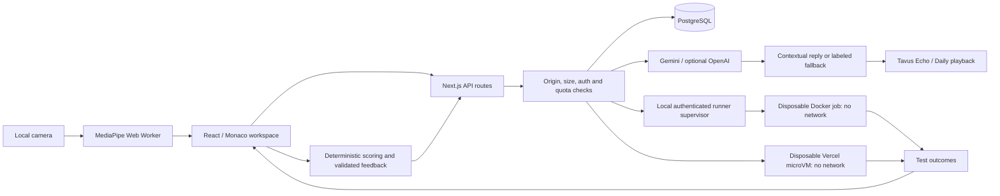

# Architecture

Umao is an interview-practice application, not a proctored exam or validated hiring assessment.

## Request Boundaries

State-changing routes reject cross-site origins and bound request bytes before JSON parsing. Sensitive provider routes require a session before calling external services. Fixed-window quotas are keyed by hashed IP/scope and, for signed-in requests, user/scope. PostgreSQL row locks keep counters consistent across application instances; local memory quotas are development-only. Throttled requests return `429` and `Retry-After`; unavailable quota storage fails closed with `503`.

Only Vercel's overwritten client-address header is trusted on Vercel. Outside Vercel, the conservative shared `local` bucket is used; configure a trusted-proxy strategy before hosting the public application elsewhere. A shared-IP quota can also throttle users behind the same NAT.

## Accounts and Persistence

Passwords use randomly salted asynchronous scrypt. Hashing has a bounded queue and happens outside the database transaction. Signup checks email uniqueness again inside the write transaction; login and password changes recheck the stored hash before committing. Sessions use random server-side IDs and HttpOnly, SameSite=Lax cookies, Secure in production. Changing the password invalidates other sessions.

The existing PostgreSQL adapter deliberately retains the `umao_state` JSONB row to preserve deployed accounts. `SELECT ... FOR UPDATE` serializes mutations, including bounded quota buckets and avatar ownership records. Rollback and concurrency are integration-tested. This is a small-demo storage design, **not a normalized or high-throughput schema**. Reads load the state snapshot, and all writes contend on one row. A relational migration with per-user queries, constraints, and indexes remains future work; no production migration was run for this change.

Local JSON storage uses atomic renames, restrictive file permissions, and a same-process write queue. It is development-only, not a multi-process database. Vercel rejects missing persistent storage.

## Execution Lifecycle

Next.js never executes submitted code on its host in production. On Vercel, it creates a new nonpersistent Sandbox microVM per request using a project-scoped language runtime image. Network egress is denied, no ports are exposed, no application secrets are passed in, and the VM has a short expiration. Only execution helpers and that request's problem/code are uploaded. Output is bounded and cleanup deletes the VM after success or failure. Provider quotas can make code execution temporarily unavailable; it never falls back to the application host.

For local development or other hosts, Next.js sends a bounded request to a token-authenticated Docker supervisor. The supervisor starts separate disposable containers for compilation/execution commands, with no network, a read-only root filesystem, an unprivileged UID, dropped capabilities, and CPU/memory/process limits. Only that job's workspace is mounted. Timeouts, output caps, disconnects, and shutdown cancel execution; cleanup is awaited before completing the command. Cleanup failure rejects further jobs until restart.

Docker isolation reduces risk but is not a proof against kernel vulnerabilities. A container-side watchdog bounds commands even if the supervisor crashes; stopped containers/workspaces after an abrupt host failure still require operational cleanup. The supervisor needs access to Docker and must run on a dedicated host, away from the application database and provider secrets. Candidate containers never receive the Docker socket. See [Security](SECURITY.md).

## Scoring and Failure Behavior

Coding scores use test outcomes, not speed bonuses for failed code. An unrun or empty answer earns no solved-problem credit. Communication feedback requires sufficient candidate evidence and bounded dimensions; camera presence or speaking duration cannot manufacture a communication score. Quotes supporting strengths must occur in candidate answers; supplied starter code cannot be claimed as candidate work.

Gemini text failures return a visibly labeled deterministic fallback; unexpected alternative-provider failures return a sanitized unavailable response. AI feedback failures preserve local feedback rather than inventing an AI score. Avatar ownership is checked before ending a provider session. Browser speech recognition can fail independently of microphone permission; typed responses remain available.

Saved result fields are validated and scoped to the authenticated user, but scores still originate from the browser. A user can manipulate their own practice record. Server-attested execution receipts and recomputed scoring would be required for trusted assessment results.

Camera analysis estimates face presence and head direction locally, not exact gaze or emotions. Raw frames, landmarks, and microphone audio are not stored in history. Text answers/code/context are sent to the configured text provider; avatar speech is sent to Tavus.
